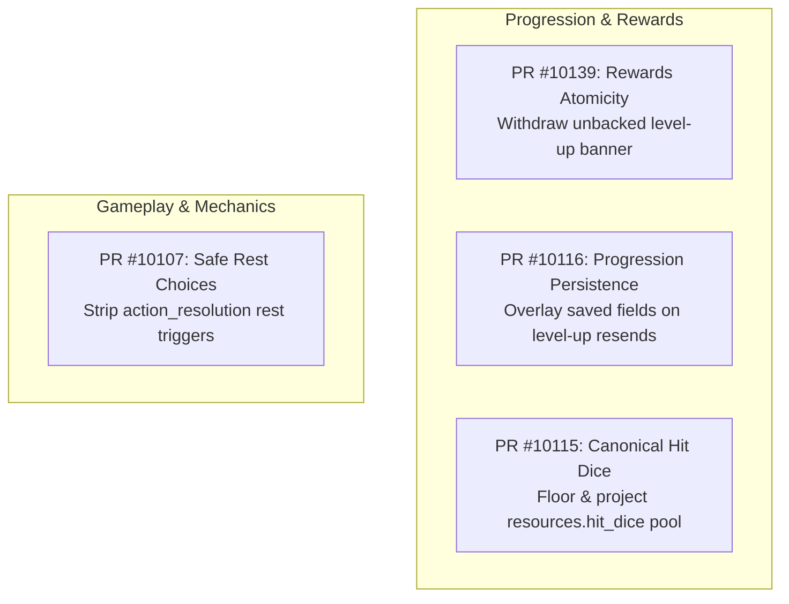

# PR Summary Specification (`/pr-summary`)

## Core Principle
When explaining, reviewing, or summarizing pull requests to the user or between agents, adhere strictly to this structured format. It provides complete architectural clarity, exact code provenance, concrete failure modes, and technical implementation details without hand-waving or vague generalities.

## Standard PR Explanation Format

### 1. High-Level Flow / Architecture Diagram
Begin with a Mermaid flowchart or state diagram showing the relationship between the PRs, systems, or data pipelines touched across the set of changes:

### 2. Per-PR Structured Breakdown
For each PR, provide:

#### Header & Provenance
- **GitHub URL**: Full clickable GitHub URL (e.g., `https://github.com/OWNER/REPO/pull/123`)
- **Branch / Head**: Branch name and exact commit SHA (e.g., `codex/8931-replacement-20261004` at `eb1c1b1f50a1f8a08f29815133065d28135ff966`)
- **Line Delta**: Explicit production vs non-production LOC deltas, broken out as added/deleted (e.g., `Production: +22 / -16 | Non-production: +426 / -16 (Total: 480 [+448 / -32])`)
- **Touched Files**: Plaintext clickable paths to all primary production files and key test/infrastructure files.

#### `### Why It Is Needed`
Enumerate distinct, numbered concrete reasons covering:
1. **Root Cause & Pre-Existing Defect**: Exactly what broke, why it failed, or what state discrepancy existed in prior commits/main.
2. **Real-World Reproduction / Trigger**: The specific user action, model output, or system event that exposed the bug.
3. **UX & Operational Consequences**: What the player, developer, or test harness observed (e.g., blank cards, dead UI banners, stuck loops, CPU thrashing).

#### `### How It Works`
Enumerate distinct, numbered technical implementation mechanisms:
1. **Architectural Design & Contracts**: The design decision, schemas, or protocols introduced.
2. **Exact Implementation Details**: Specific classes, functions, and lines modified, detailing input/output transformations and data flow.
3. **Invariants, Edge Cases & Safeguards**: Bounded conditions, fallback removals, UX-first preservation, and failure modes handled.
4. **Verification & Test Coverage**: Targeted unit, integration, and real-LLM streaming tests verifying the change.

#### `### Zero-Framework Cognition (ZFC) Audit` (when applicable)
Resolve the active repository’s ZFC skills first. Verify model vs backend ownership:
- **Model Decides**: Did the LLM make the semantic judgment, select intent, and author the target state?
- **Server Executes**: Is the backend restricted to executing tool operations, deterministic persistence, schema normalization, and UI projection?
- **Anti-Pattern Check**: Verify that no regex parsing, hardcoded gameplay heuristics, procedural game rules, or keyword matching were added to backend code.

#### `### What to Review as a Human`
Follow `${CLAUDE_HOME:-$HOME/.claude}/skills/human-review-brief/SKILL.md` (canonical owner — never list LLM-verifiable checks; every item requires `Why the LLM cannot do this:`).

---

- **Persistent summary**: Use the task's authorized destination or the configured roadmap repository (`ROADMAP_DIR`, resolved by the [roadmap skill](../roadmap/SKILL.md)). Save `pr-summary-YYYY-MM-DD-<slug>.md` and follow that repository's publication rules. If no durable destination is configured, return the summary and state that it was not saved. Do not create a separate summary branch or PR.
- **Required Output Links**: Every `/pr-summary` report MUST explicitly provide:
  - The full clickable GitHub URL for each summarized PR (e.g. `https://github.com/OWNER/REPO/pull/123`).
  - For a saved summary, provide the verified shareable link when available, or the resolved absolute local path with a `file:///` link when the reader can open it.
- **Full Absolute Plaintext Paths**: Use full absolute filesystem paths at runtime (e.g. `/absolute/project/src/example.py`). Never truncate to bare basenames.
- **Clickable Markdown**: Format paths as normal prose or markdown links with `file:///` so they remain clickable in all agent environments.
- **Empirical Rigor**: Ground all claims in real telemetry, PR diffs, and test runs. Never speculate from static reading alone.
