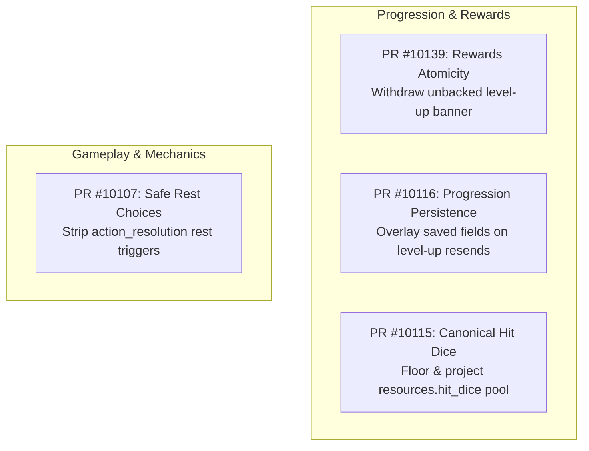

# PR Summary Specification (`/pr-summary`)

## Core Principle
When explaining, reviewing, or summarizing pull requests to the user or between agents, adhere strictly to this structured format. It provides complete architectural clarity, exact code provenance, concrete failure modes, and technical implementation details without hand-waving or vague generalities.

## Standard PR Explanation Format

### 1. High-Level Flow / Architecture Diagram
Begin with a Mermaid flowchart or state diagram showing the relationship between the PRs, systems, or data pipelines touched across the set of changes:

### 2. Per-PR Structured Breakdown
For each PR, provide:

#### Header & Provenance
- **GitHub URL**: Full clickable GitHub URL (e.g., `https://github.com/jleechanorg/worldarchitect.ai/pull/10107`)
- **Branch / Head**: Branch name and exact commit SHA (e.g., `codex/8931-replacement-20261004` at `eb1c1b1f50a1f8a08f29815133065d28135ff966`)
- **Line Delta**: Explicit production vs non-production LOC deltas, broken out as added/deleted (e.g., `Production: +22 / -16 | Non-production: +426 / -16 (Total: 480 [+448 / -32])`)
- **Touched Files**: Plaintext clickable paths to all primary production files and key test/infrastructure files.

#### `### Why It Is Needed`
Enumerate distinct, numbered concrete reasons covering:
1. **Root Cause & Pre-Existing Defect**: Exactly what broke, why it failed, or what state discrepancy existed in prior commits/main.
2. **Real-World Reproduction / Trigger**: The specific user action, model output, or system event that exposed the bug.
3. **UX & Operational Consequences**: What the player, developer, or test harness observed (e.g., blank cards, dead UI banners, stuck loops, CPU thrashing).

#### `### How It Works`
Enumerate distinct, numbered technical implementation mechanisms:
1. **Architectural Design & Contracts**: The design decision, schemas, or protocols introduced.
2. **Exact Implementation Details**: Specific classes, functions, and lines modified, detailing input/output transformations and data flow.
3. **Invariants, Edge Cases & Safeguards**: Bounded conditions, fallback removals, UX-first preservation, and failure modes handled.
4. **Verification & Test Coverage**: Targeted unit, integration, and real-LLM streaming tests verifying the change.

#### `### Zero-Framework Cognition (ZFC) Audit`
Verify model vs backend ownership:
- **Model Decides**: Did the LLM make the semantic judgment, select intent, and author the target state?
- **Server Executes**: Is the backend restricted to executing tool operations, deterministic persistence, schema normalization, and UI projection?
- **Anti-Pattern Check**: Verify that no regex parsing, hardcoded gameplay heuristics, procedural game rules, or keyword matching were added to backend code.

#### `### What to Review as a Human`
Follow `${CLAUDE_HOME:-$HOME/.claude}/skills/human-review-brief/SKILL.md` (canonical owner — never list LLM-verifiable checks; every item requires `Why the LLM cannot do this:`).

---

- **Persistent Roadmap Document & PR**: Every `/pr-summary` execution MUST persist the complete summary markdown document to `~/roadmap/` named `pr-summary-YYYY-MM-DD-<slug>.md` (or `pr-summary-<pr_number>-<slug>.md` for single PRs). Version each summary through the roadmap repository's normal PR workflow: create a task-specific branch from the current `origin/main` tip; if the canonical checkout contains unrelated changes, use the repository's isolated worktree workflow. Stage only this summary file by explicit path, commit with the usual CLI/model provenance, push the branch with upstream tracking, and open or update a PR against `main`. Follow the [PR-workflow manager](../pr-workflow-manager/SKILL.md) for branch verification and stage handling. Never stage the whole roadmap tree or push directly to `main`. Follow the existing review and merge authorization gates; persisting a summary does not bypass them.
- **Required Output Links**: Every `/pr-summary` report MUST explicitly provide:
  - The full clickable GitHub URL for each summarized PR (e.g. `https://github.com/jleechanorg/worldarchitect.ai/pull/10107`).
  - The local file URL with `file:///` scheme (e.g. `[Local Roadmap Doc](file:///$HOME/roadmap/pr-summary-YYYY-MM-DD-<slug>.md)`) AND the unabbreviated plaintext filesystem path (e.g. `$HOME/roadmap/pr-summary-YYYY-MM-DD-<slug>.md`).
- **Full Absolute Plaintext Paths**: Use full absolute filesystem paths at runtime (e.g. `$HOME/projects/worktree_small_prs/mvp_site/game_state_merge.py`). Never truncate to bare basenames.
- **Clickable Markdown**: Format paths as normal prose or markdown links with `file:///` so they remain clickable in all agent environments.
- **Empirical Rigor**: Ground all claims in real telemetry, PR diffs, and test runs. Never speculate from static reading alone.
